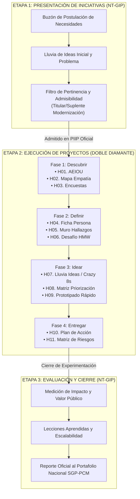

# INFORME TÉCNICO Y PLAN DE IMPLEMENTACIÓN: ALCANCES SGP-PCM
## Adaptación del Prototipo PIIP (AGROIDEAS) a la Norma Técnica de Gestión de la Innovación Pública (NT-GIP)

**Fecha:** 12 de noviembre de 2026  
**Referencia:** Correo electrónico *Innovación SGP (PCM)* a *Alex Abad Escalante (AGROIDEAS)* del 11/11/2026  
**Documento Fuente:** `Document/Correo - Comentarios_Presentación PIIP AGROIDEAS.pdf`  
**Marco Normativo:** Resolución de Secretaría de Gestión Pública N° 003-2025-PCM-SGP (NT-GIP)  
**Proyecto:** Portafolio Institucional de Innovación Pública (PIIP) - Metodología Doble Diamante  

---

## 1. RESUMEN EJECUTIVO Y DIAGNÓSTICO DE SITUACIÓN

### 1.1. Contexto de la Observación de SGP-PCM
La **Secretaría de Gestión Pública de la Presidencia del Consejo de Ministros (SGP-PCM)**, como ente rector del Sistema Administrativo de Modernización de la Gestión Pública, evaluó la plataforma desarrollada por **AGROIDEAS**. 

Si bien felicitan el carácter propositivo del aplicativo, identificaron una **brecha conceptual clave**:
> **El prototipo actual fue construido casi exclusivamente para la "Ejecución Metodológica de Proyectos" (las 4 fases del Doble Diamante), omitiendo la gobernanza previa y posterior que exige la NT-GIP para que una iniciativa ingrese, se valide, se oficialice y se reporte al Estado.**

### 1.2. Cuadro Comparativo: Estado Actual vs. Requerimiento SGP-PCM

| Dimensión | Estado Actual del Prototipo | Lo que Solicita SGP-PCM | Impacto en la Solución |
| :--- | :--- | :--- | :--- |
| **Navegación / Menú (Frontend)** | Barra lateral con 11 herramientas divididas solo en 4 fases del Doble Diamante (Descubrir, Definir, Idear, Entregar). | Segmentar la barra en las **3 Etapas de la NT-GIP**: (1) Presentación de iniciativas, (2) Ejecución de proyectos, (3) Evaluación. | Reestructuración de `js/layout.js`, nuevo panel de postulación/lluvia de ideas inicial y módulo de evaluación. |
| **Flujo de Trabajo (Backend / Gobernanza)** | Edición directa en la tabla de proyectos. Sin estados de aprobación ni roles de custodia. | Flujo interno formal de registro, validación y seguimiento, con figura de **Titular y Suplente** en la Unidad de Modernización. | Workflow de estados: *Borrador → En Revisión → Admitido PIIP → En Ejecución → Evaluado*. |
| **Perfiles de Usuario (Full-stack)** | Sin login ni roles reales (un solo badge decorativo de "Admin UPP"). | Al menos **2 perfiles diferenciados**: (1) Servidor Unidad Modernización, (2) Servidor/Equipo de Proyecto. | Módulo RBAC de autenticación/sesión simulada con permisos de lectura/escritura condicionales por vista y botón. |

---

## 2. DESGLOSE DETALLADO DE LOS TRES ALCANCES SOLICITADOS

```
                             CICLO COMPLETO NT-GIP (PCM)
 ┌─────────────────────────────────────────────────────────────────────────────┐
 │  ETAPA 1: PRESENTACIÓN        ETAPA 2: EJECUCIÓN           ETAPA 3: EVALUACIÓN  │
 │  (Cualquier Servidor)         (Equipos de Proyecto)        (Modernización)     │
 │                                                                             │
 │  • Buzón / Postulación        • F1: Descubrir (H01-H03)    • Medición Impacto   │
 │  • Comprensión Problema       • F2: Definir   (H04-H06)    • Lecciones Aprend.  │
 │  • Lluvia Ideas temprana      • F3: Idear     (H07-H09)    • Escalabilidad      │
 │  • Filtro Admisibilidad       • F4: Entregar  (H10-H11)    • Reporte SGP-PCM   │
 └───────────────────────────────┴────────────────────────────┴─────────────────┘
                                ▲                              ▲
                                │                              │
                Custodiado por: TITULAR Y SUPLENTE (Unidad de Modernización)
```

---

### EJE 1: SEGMENTACIÓN DE LA CAJA DE HERRAMIENTAS SEGÚN LA NT-GIP (FRONT-END)

#### ¿Qué está pidiendo la SGP-PCM?
La SGP señala que la ventana actual de AGROIDEAS está hiperenfocada en la *ejecución* (las 11 herramientas del Doble Diamante). La norma técnica exige que la plataforma acompañe a la entidad desde antes (cuando surge una idea o problema sin estructurar) hasta después (cuando se evalúa el resultado para rendir cuentas a la PCM).

#### Acciones Metodológicas y de UI:
1. **Reorganizar el Menú de Navegación (`js/layout.js`):**
   * Crear tres grandes bloques colapsables o secciones principales en el Sidebar:
     * **Etapa 1: Presentación de Iniciativas (Fase Previa)**
     * **Etapa 2: Ejecución de Proyectos (Doble Diamante)**
     * **Etapa 3: Evaluación y Cierre (Fase Posterior)**
2. **Incorporar Herramienta de Ideación / Comprensión Temprana del Problema:**
   * Diseñar una vista ágil para que cualquier servidor de la entidad ingrese una *Manifestación de Necesidad* o *Lluvia de Ideas Inicial*, sin necesidad de dominar previamente toda la metodología de investigación en campo.
3. **Módulo de Evaluación de Resultados:**
   * Diseñar una vista de evaluación ex-post que consolide indicadores de valor público, nivel de madurez alcanzado y ficha de cierre para el reporte nacional a la SGP-PCM.

#### Componentes a Desarrollar (Frontend):
* `CajaHerramientasNTGIP` (`js/layout.js`): Componente de menú segmentado en 3 acordeones metodológicos con badges de conteo de herramientas.
* `ViewPresentacionIniciativa` (`iniciativas/presentacion.html`): Formulario simplificado ("Buzón de Iniciativas de Innovación") con:
  * Planteamiento del problema en lenguaje ciudadano/institucional.
  * Mapeo rápido de causas preliminares (lluvia de ideas inicial / árbol de problemas rápido).
  * Equipo proponente y unidad orgánica postulante.
* `ViewEvaluacionProyecto` (`evaluacion/cierre.html`): Panel de evaluación con métricas de valor público (ahorro en tiempos, costos, satisfacción de usuarios agrarios y escalabilidad técnica).

#### Funciones a Desarrollar (Frontend / Lógica de Interfaz):
* `renderSidebarPorEtapas()`: Renderiza dinámicamente las herramientas agrupadas según la etapa normativa activa.
* `validarTransicionEtapa()`: Bloquea o alerta si un proyecto intenta pasar a Ejecución sin haber completado la admisión en Presentación.
* `capturarLluviaIdeasTemprana(iniciativaId, data)`: Función reactiva para almacenar propuestas iniciales antes de crear formalmente un proyecto PIIP.

---

### EJE 2: FLUJO DE TRABAJO Y CUSTODIA INSTITUCIONAL (BACK-END / LÓGICA DE NEGOCIO)

#### ¿Qué está pidiendo la SGP-PCM?
La SGP advierte sobre la necesidad de **salvaguardar la información institucional**. En el prototipo actual, cualquier persona con acceso a la web puede alterar datos del PIIP, crear proyectos directos o recargar semillas. 

La norma técnica exige que exista un **flujo formal** donde la **Unidad de Modernización (con un Titular y un Suplente formalmente designados)** sea la única autorizada para:
- Admitir o rechazar iniciativas que postulen las áreas.
- Oficializar registros en el Portafolio Institucional (PIIP).
- Aprobar el cierre de fases y certificar la veracidad de los datos que se reportan a la Alta Dirección y a la SGP-PCM.

#### Acciones de Gobernanza y Negocio:
1. **Definir el Ciclo de Vida Formal de una Iniciativa:**
   * `Estado: POSTULADA` (Cualquier servidor la registra).
   * `Estado: EN_EVALUACION` (La Unidad de Modernización revisa pertinencia con la NT-GIP).
   * `Estado: ADMITIDA_PIIP` (Se le asigna código oficial `PIIP-2026-INxxxx` y equipo formal).
   * `Estado: EN_EJECUCION` (Se habilitan las 11 herramientas del Doble Diamante).
   * `Estado: COMPLETADA / EVALUADA` (Se elabora el informe de cierre para SGP-PCM).
2. **Definir Responsables Formales de Custodia:**
   * Asignar en el sistema las identidades del **Titular de Modernización** y **Suplente de Modernización**, con registro de firmas o marcas de auditoría (`modificado_por`, `fecha_hora`, `version`).

#### Componentes a Desarrollar (Lógica / Backend):
* `WorkflowManager` (`js/workflow.js`): Módulo de máquina de estados finitos que controla los estados del proyecto y los disparadores de cambio de estado.
* `AuditoriaLogger` (`js/database.js`): Registro inmutable en el motor de base de datos local (o API REST futura) con el histórico de cambios, usuario que ejecutó la acción y timestamp.
* `ModalRevisionIniciativa` (`index.html`): Ventana de dictamen para el Titular/Suplente (Aprobar con observaciones, Rechazar, Admitir a PIIP).

#### Funciones a Desarrollar (Lógica de Datos):
* `cambiarEstadoProyecto(projectId, nuevoEstado, usuarioOperador)`: Valida si el usuario tiene rol de Titular/Suplente antes de autorizar la transición.
* `registrarIniciativaBorrador(payload)`: Permite guardar una propuesta preliminar sin contaminar el listado oficial de proyectos admitidos en el PIIP.
* `asignarCustodioModernizacion(tipoCustodio: 'titular' | 'suplente', usuarioId)`: Registra a los funcionarios responsables en los metadatos institucionales.
* `obtenerHistorialAuditoria(projectId)`: Retorna la trazabilidad completa de aprobaciones y modificaciones.

---

### EJE 3: DEFINICIÓN DE PERFILES DE USUARIO (FULL-STACK / RBAC)

#### ¿Qué está pidiendo la SGP-PCM?
Definir claramente qué usuarios interactúan con la plataforma y delimitar sus facultades para responder a sus necesidades específicas sin vulnerar la integridad de los datos.

La SGP propone explícitamente dos tipos de perfiles:
1. **Perfil 1: Servidor de la Unidad de Modernización (Titular / Suplente)**
   * *Privilegios:* Administrador del Portafolio. Puede crear, editar, aprobar iniciativas en el PIIP, calificar rúbricas, supervisar el avance institucional y exportar datos a la PCM.
2. **Perfil 2: Servidor de la Entidad / Integrante de Equipo de Proyecto (Innovador)**
   * *Privilegios:* Formulador / Colaborador. No puede manipular la base del PIIP oficial ni cambiar estados institucionales, pero tiene acceso pleno a trabajar dentro de las herramientas metodológicas (Ficha de Persona, Muro de Hallazgos, Matriz de Priorización, Lluvia de Ideas, Prototipado, etc.) del proyecto al que fue asignado.

#### Matriz de Roles y Permisos (RBAC):

| Capacidad del Sistema | Perfil 1: Unidad de Modernización (Titular / Suplente) | Perfil 2: Servidor Innovador / Equipo de Proyecto |
| :--- | :---: | :---: |
| **Ver Dashboard PIIP General** | ✅ Completo (Ver todo) | 👁️ Solo Lectura de iniciativas públicas |
| **Registrar Nueva Iniciativa Oficial** | ✅ Sí | ❌ No (Solo postula en "Buzón de Entrada") |
| **Aprobar / Pasar de Fase en el PIIP** | ✅ Sí (Dictamen vinculante) | ❌ No |
| **Editar Datos Generales del Proyecto** | ✅ Sí | ❌ No (Solo lectura) |
| **Usar Herramientas Doble Diamante (H01-H11)** | 👁️ Visualizar y auditar | ✏️ Edición colaborativa completa |
| **Votar en Matriz de Priorización** | 👁️ Voto dirimente / Observador | ✏️ Votación activa de ideas |
| **Generar Reporte Oficial para SGP-PCM** | ✅ Sí | ❌ No |
| **Reiniciar Base de Datos / QA Seed** | ⚠️ Solo Titular / Administrador | ❌ Oculto / Deshabilitado |

#### Componentes a Desarrollar (Full-stack):
* `SelectorPerfilSesion` (`js/layout.js`): Switch o modal en la barra lateral para alternar fácilmente entre Perfil 1 y Perfil 2 (útil tanto para demostraciones inmediatas con SGP-PCM como para integración con Active Directory / CAS en producción).
* `GuardsDeInterfaz` (`js/auth.js`): Mapeo declarativo en elementos del DOM (`data-role-required="modernizacion"`) que oculta o desactiva botones (ej. "Registrar Nueva Iniciativa", "Recargar Datos Semilla", "Aprobar Fase") si la sesión activa es de un Servidor de Proyecto.

#### Funciones a Desarrollar:
* `establecerPerfilActivo(rol: 'modernizacion_titular' | 'modernizacion_suplente' | 'equipo_proyecto')`: Almacena el rol en sesión.
* `verificarPermiso(accion: string)`: Devuelve `true`/`false` según el rol activo.
* `aplicarRestriccionesDOM()`: Recorre la vista actual y aplica estilos de solo lectura o deshabilita botones según el perfil.

---

## 3. MAPA METODOLÓGICO ARMONIZADO: NT-GIP + DOBLE DIAMANTE



---

## 4. PLAN DE TRABAJO Y ROADMAP DE IMPLEMENTACIÓN

Para presentar a la SGP-PCM una respuesta contundente con avances demostrables, se propone un despliegue en tres fases:

### Fase A: Gobernanza de Perfiles y Segmentación del Layout (Front-end & Auth)
- [ ] **A.1:** Crear `js/auth.js` con el modelo de dos perfiles (Unidad de Modernización vs. Equipo de Proyecto).
- [ ] **A.2:** Actualizar el Sidebar en `js/layout.js` para incorporar:
  * Selector rápido de perfil activo en el pie del sidebar.
  * Reorganización de enlaces en las 3 macro-etapas: *Presentación de Iniciativas*, *Ejecución (Doble Diamante)*, *Evaluación*.
- [ ] **A.3:** Ocultar botones críticos (creación de iniciativas maestras, recarga de base de datos) para el perfil de Equipo de Proyecto.

### Fase B: Flujo Interno de Trabajo y Buzón de Iniciativas (Back-end / Lógica)
- [ ] **B.1:** Crear la vista `iniciativas/presentacion.html` para la postulación de ideas tempranas y formulación del problema.
- [ ] **B.2:** Ampliar el esquema de datos en `data/seed.js` y `js/database.js` con estados de ciclo de vida (`postulada`, `en_evaluacion`, `admitida`, `en_ejecucion`, `evaluada`) y los roles de *Titular* y *Suplente*.
- [ ] **B.3:** Integrar el botón de revisión/dictamen de admisión exclusivo para la Unidad de Modernización.

### Fase C: Módulo de Evaluación y Reporte a la SGP-PCM
- [ ] **C.1:** Crear la vista `evaluacion/cierre.html` con indicadores de valor público y lecciones aprendidas.
- [ ] **C.2:** Habilitar exportación estructurada (PDF / JSON) de la ficha de proyecto alineada al formato de reporte de la SGP-PCM.

---

## 5. CONCLUSIÓN Y RECOMENDACIÓN ESTRATÉGICA

El correo de la SGP-PCM no representa una crítica a lo construido, sino una **señal de validación y alto interés gubernamental**: quieren que el aplicativo de AGROIDEAS no sea solo un taller digital de diseño, sino el **sistema modelo de gestión de innovación pública para las entidades del Estado**.

Adoptar estos tres ajustes (Segmentación en 3 etapas, Flujo formal con Titular/Suplente, y Perfiles RBAC) posicionará a AGROIDEAS como el referente pionero en el cumplimiento de la **NT-GIP N° 003-2025-PCM-SGP**.

